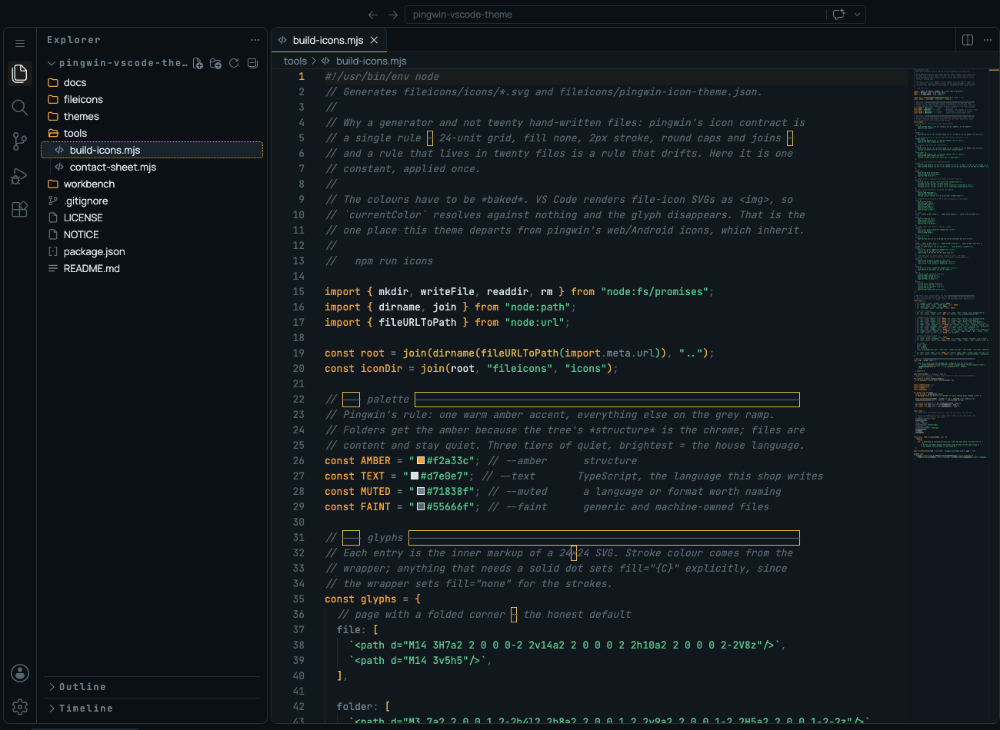
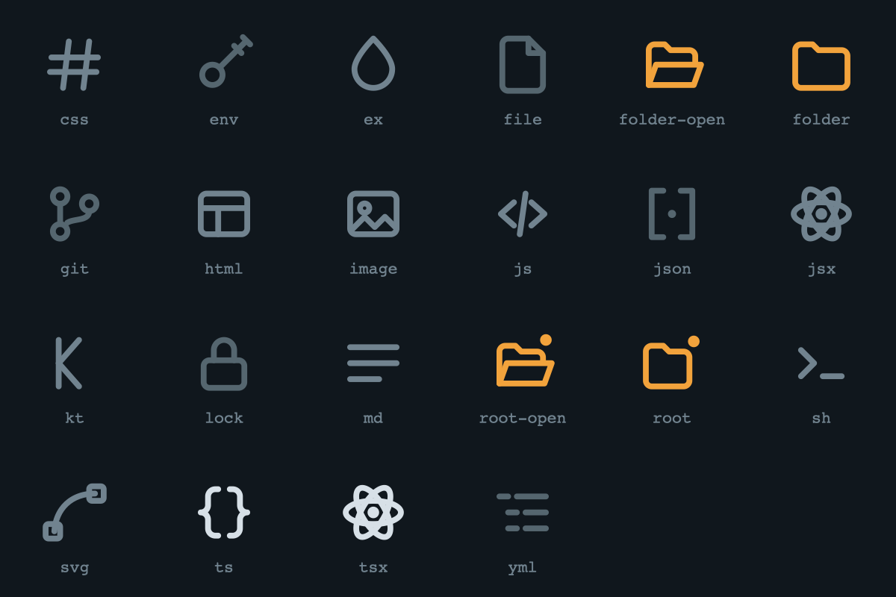

# pingwin-vscode-theme

A dark VS Code theme in the [pingwin](https://github.com/ekomardiatno) design
language — cold ink, one warm transmission amber, and a three-voice type system.
Colours, file icons and the workbench UI font, so the editor matches the apps
written in it.



Built for [code-server](https://github.com/coder/code-server) but it is an
ordinary VS Code extension; only the font half is code-server specific.

---

## The rule it follows

Pingwin's theme file states it in one line:

> One warm amber accent (tower beacon); green/red appear only as status
> semantics, never as chrome.

That is easy to honour in an app with twelve controls and awkward in an editor,
where syntax highlighting traditionally wants a rainbow. This theme keeps the
rule. **No colour appears here that does not already exist in pingwin**:

| Role                        | Token         | Where it shows up                                   |
| --------------------------- | ------------- | --------------------------------------------------- |
| accent                      | amber `#f2a33c` | keywords, numbers, buttons, active tab and nav borders |
| attention, one step down    | warn `#e0b84c`  | functions, types                                    |
| something succeeded         | ok `#57c78a`    | strings, added lines                                |
| something is wrong          | danger `#e05f5f`| errors, deleted lines                               |
| everything else             | the grey ramp   | variables, properties, punctuation, comments        |

The one deliberate exception is the sixteen ANSI terminal slots. Programs
address those by index, so blue, cyan and magenta have to exist or `ls`, `npm`
and `git` output stop meaning anything. They are desaturated to sit on ink
rather than shout from it.

### Elevation

Four surfaces, and every part of the workbench picks exactly one:

```
#0b1014  ink         chrome      activity bar, side bar, status bar, title bar
#10171d  ink-raise   your work   editor, active tab, terminal
#19232c  panel-high  floating    suggest widget, hovers, menus, notifications
#080c0f  ink-press   recessed    inputs, dropdowns, peek editor, code blocks
```

The editor is **lighter** than the chrome around it. That is backwards from most
dark themes and deliberate: the thing you are working on should be the lit one.

---

## Layout

```
themes/      the colour theme
fileicons/   the icon theme + generated SVGs
tools/       the icon generator and a contact-sheet renderer
workbench/   the UI-font stylesheet, its installer, and the three fonts
```

---

## Install

### The extension (colours + icons)

Clone straight into the extensions folder. There is no build step — the icon
SVGs are committed.

```sh
# code-server
git clone https://github.com/ekomardiatno/pingwin-vscode-theme.git \
  ~/.local/share/code-server/extensions/ekomardiatno.pingwin-vscode-theme

# desktop VS Code
git clone https://github.com/ekomardiatno/pingwin-vscode-theme.git \
  ~/.vscode/extensions/ekomardiatno.pingwin-vscode-theme
```

Restart, then pick **Pingwin** in both *Preferences: Color Theme* and
*Preferences: File Icon Theme* — or set them directly:

```json
{
  "workbench.colorTheme": "Pingwin",
  "workbench.iconTheme": "pingwin"
}
```

### The fonts

The editor and terminal fonts are plain settings:

```json
{
  "editor.fontFamily": "'JetBrains Mono', ui-monospace, Menlo, monospace",
  "editor.fontLigatures": true,
  "terminal.integrated.fontFamily": "'JetBrains Mono', ui-monospace, Menlo, monospace"
}
```

On code-server you do **not** need JetBrains Mono installed on the machine for
those to work — `apply.sh` below declares it as an `@font-face` in the same
document the editor and terminal render into. Keep the fallbacks regardless:
the bundled woff2 is a Latin subset, so box drawing and powerline glyphs still
come from Menlo. On desktop VS Code, install the font normally.

The **UI** font is the hard one. VS Code hardcodes it per platform in its own
`workbench.css` and exposes no setting, so the only way in is a stylesheet
loaded afterwards. For code-server:

```sh
./workbench/apply.sh
```

That copies `pingwin-workbench.css` and the three woff2 files into
`src/browser/pages/` and adds one `<link>` to `workbench.html`. It backs up the
original and is safe to run repeatedly.

> **Re-run it after every code-server upgrade.** A new release replaces the
> install tree wholesale, which takes the link with it. The extension survives;
> this does not.

To undo it, restore the backup:

```sh
mv workbench.html.orig workbench.html
```

---

## Working on the icons



Every glyph lives in one table in `tools/build-icons.mjs` — path data, colour
tier, and the extensions/filenames/languages it answers to. The 24-unit grid,
2px stroke and round caps are applied once, in the generator, so they cannot
drift across twenty files.

```sh
npm run icons     # regenerate fileicons/icons/*.svg + the theme JSON
npm run sheet     # also write /tmp/pingwin-icons.svg — then look at it
```

The second command matters. An icon set that compiles is not an icon set that
reads; the contact sheet puts all of them on the real background at the real
size, which is the only way to catch two glyphs that turn out to be the same
picture.

Colours are **baked into the SVGs**, not inherited. VS Code draws file icons as
``, so `currentColor` resolves against nothing and the glyph vanishes. It
is the one place this set departs from pingwin's web and Android icons.

---

## Licence

MIT — see [LICENSE](LICENSE). The bundled fonts are under the SIL Open Font
License 1.1; see [NOTICE](NOTICE).
